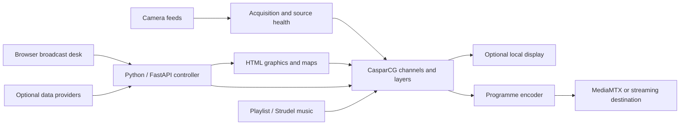

# Broadcast Station

A self-hosted television channel for Linux, built around CasparCG and a browser-based broadcast desk. Combine cameras, aircraft and vessel maps, weather, news and music into a scheduled programme. Station names, logos, feeds and output profiles are configurable.

**Public source alpha.** Tested configurations include NVIDIA 2160p30 and a limited Intel 1080p30 standby workload. This release provides source and build instructions, not prebuilt native engine images. See [release status](docs/RELEASE-CHECKLIST.md) for measured limits and remaining acceptance work.


## What it does

- Runs camera and information scenes through scheduled rundowns, timed segments and manual takes.
- Uses conditional cues and local-hour clock rules for briefings, weather, travel, harbour, sky, calendar and replay screens.
- Keeps camera acquisition and recovery separate from programme switching, with fallback graphics for unavailable sources.
- Renders aircraft and vessel maps, weather and radar, tides, daylight, markets, news and power-system information through optional providers.
- Plays local music or generated Strudel music, with track selection, levels and variation controls.
- Provides operator pages for live output, rundowns, graphics, music, news, system health and setup.
- Provides a key-protected Director remote for program and rundown control on a trusted private LAN.
- Supports headless GPU playout, optional local display and encoded network output.
- Preserves station settings separately from application images, with migration, diagnostic and rollback tools.

External data adapters are optional and disabled in the demo. Provider credentials, coverage, usage costs and redistribution rights remain the station operator's responsibility. Alert presentation is not a certified public-warning receiver.

## Try the desk

With Docker Engine and Compose installed:

```sh
git clone https://github.com/andrew867/broadcast-station.git
cd broadcast-station
docker compose up --build
```

Open [the broadcast desk](http://127.0.0.1:8765/studio). This is an offline, read-only demonstration with generic assets. It does not start CasparCG, contact external providers or take control of an existing station.


For full playout, follow [Linux installation](docs/LINUX-DEPLOYMENT.md) and [headless operation](docs/HEADLESS.md). The native stack requires Linux x86_64, a compatible graphics driver and a separate engine build. The source build takes substantially longer than the interface preview. Keep the studio on a trusted host or private LAN; it has no multi-user authentication.

## How it fits together



## Tested output scope

| Configuration | Recorded result |
|---|---|
| NVIDIA 2160p30 | Production output, headless observation, receiver recordings and recovery checks. |
| Intel 1080p30 | Limited camera/map standby rotation; occasional performance dips remain documented. |
| Fresh Intel live USB | Generic GPU rendering, audio and package stop/resume verified; persistent installation and reboot still need a separate clean test. |
| 2160p60 | Tested below sustained target rate. It is not a qualified production profile. |

See [acceptance records](docs/ACCEPTANCE-STATUS.md) for exact workloads, revisions and limitations. A selectable output format does not guarantee that many distinct rendered pictures per second.

## Documentation

- [Screenshots](docs/SCREENSHOTS.md): programme graphics and operator pages.
- [Operator guide](docs/STUDIO-GUIDE.md): scenes, scheduling, music and recovery.
- [Information screens](docs/INFORMATION-SCREENS.md): conditional programming, briefings, travel, calendar and Director remote.
- [Configuration](docs/STATION-CONFIGURATION.md) and [branding](docs/BRANDING.md).
- [Installation](docs/LINUX-DEPLOYMENT.md), [headless operation](docs/HEADLESS.md) and [standby operation](docs/STANDBY.md).
- [Release checklist](docs/RELEASE-CHECKLIST.md), [support](SUPPORT.md) and [security policy](SECURITY.md).
- [Documentation index](docs/README.md), [contributing](CONTRIBUTING.md) and [CI](docs/CI-CD.md).

## Source and licences

The application uses AGPL-3.0-or-later. Independent original tools use Apache-2.0; the [CasparCG fork](https://github.com/andrew867/casparcg-server/tree/station/2.5.1) retains GPL-3.0-or-later. Third-party components retain their own licences. No proprietary NDI runtime is bundled.

Read [licensing](LICENSING.md), [third-party notices](THIRD_PARTY_NOTICES.md) and [source delivery](docs/SOURCE-AND-LICENCES.md) before redistribution. The running application's `/source` page serves its build-time application source without station settings or credentials.
