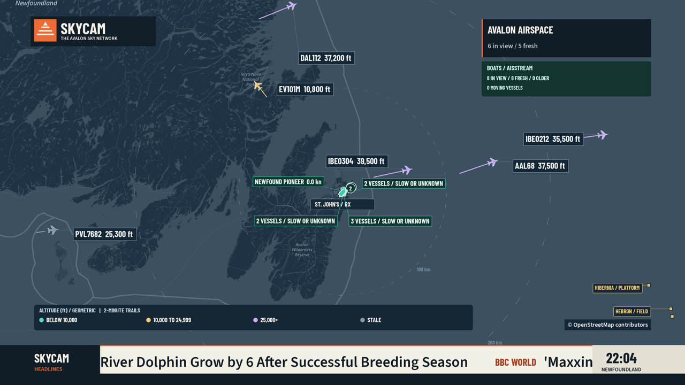
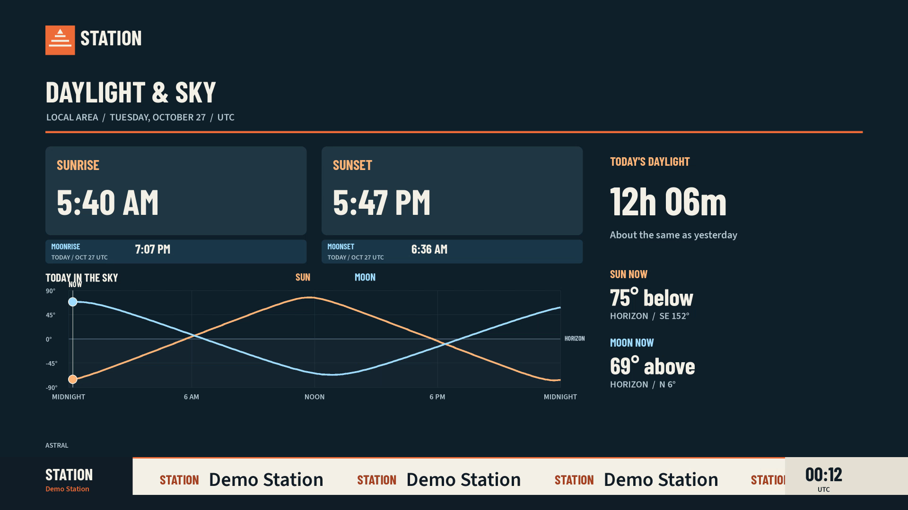
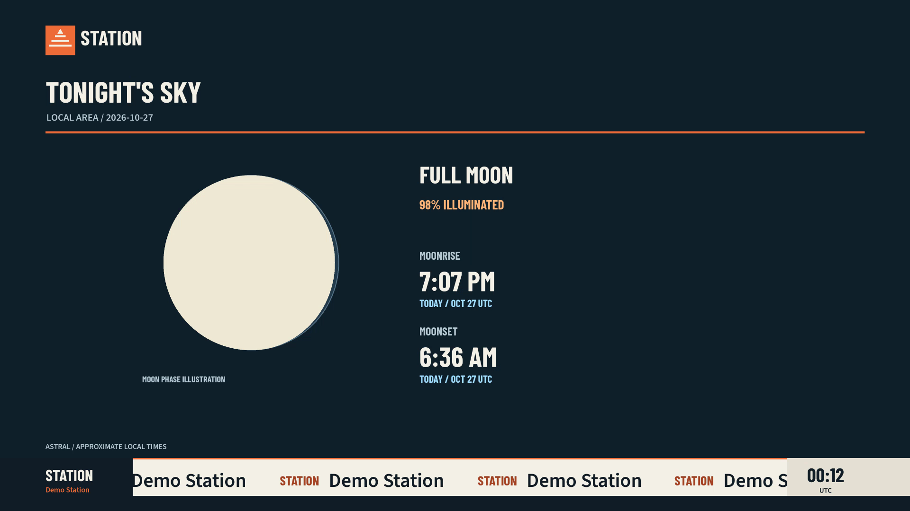
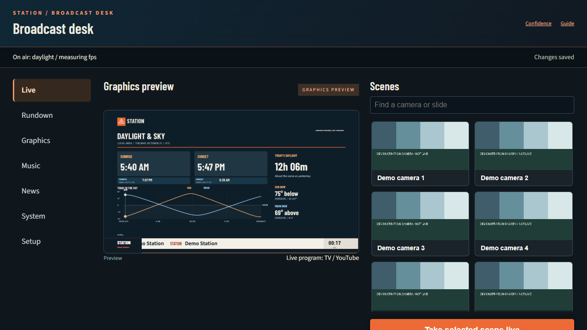
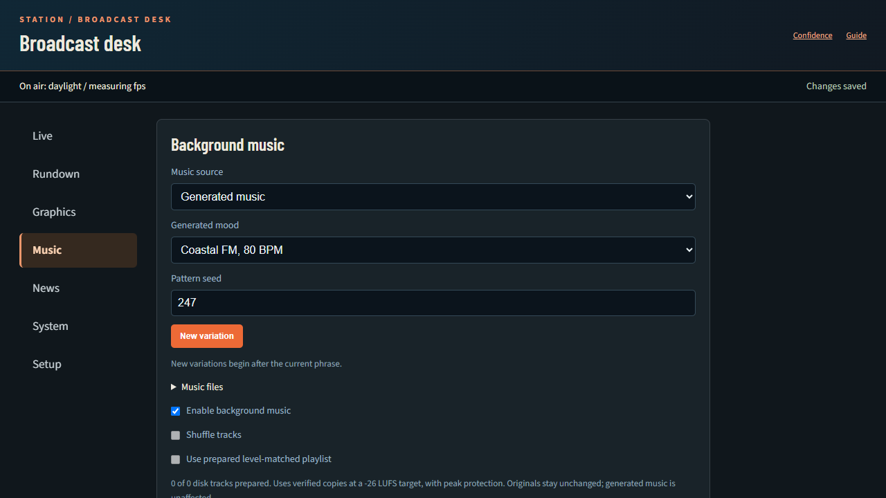
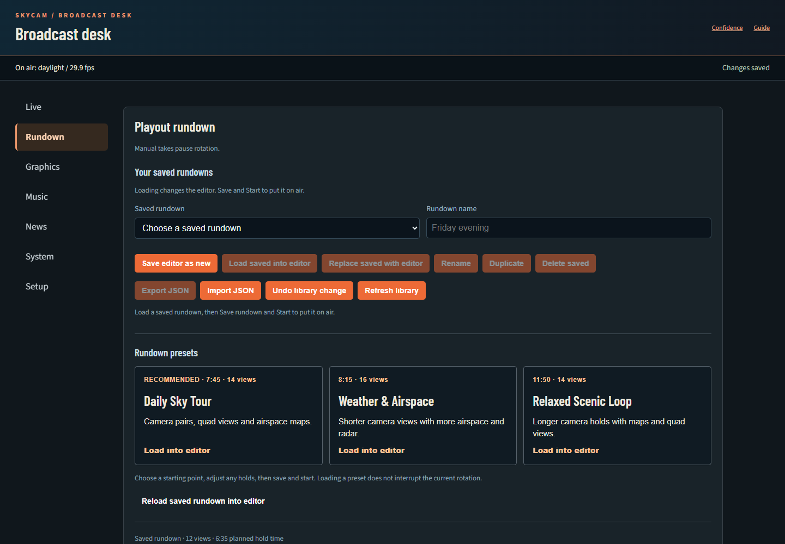

# Programme and operator screenshots

These are captures of rendered output and the browser interface, not design mockups. The configured station example uses live data and station-specific branding. Generic demo captures use offline assets; those assets are what the default Compose preview provides. Individual source and data licences still apply.

## Aircraft and vessels

The configured station's encoded programme output, showing aircraft, harbour vessel clusters, offshore landmarks and the news crawl. Map attribution remains visible.

## Daylight and lunar graphics

Generic station output from the clean Intel live-session test. The daylight diagram includes the Sun and Moon; the lunar page shows rise and set times.

## Live desk

The operator interface separates live output, scheduling, graphics, music, news, system health and setup into pages.

## Music

Generated music settings from the generic station test, with mood, seed and phrase-boundary variation controls.

## Rundown editor

The configured station's running desk, captured without changing playout. Saved rundowns and presets can be edited before being put on air.

